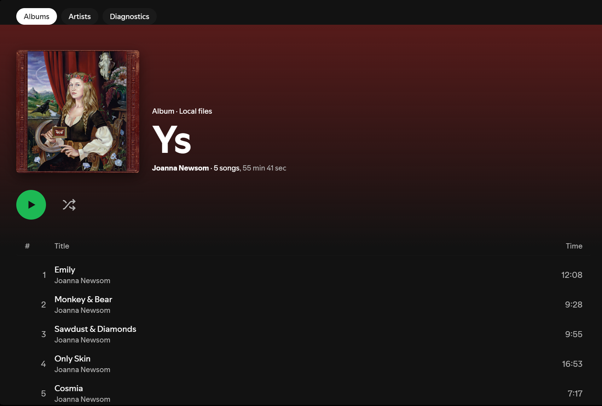

# Crate

**Your Spotify local files, as a real album library.**

Spotify shows local files as one long list of tracks. Crate turns them into albums and artists you
can browse, and opens every album like a real Spotify album page: cover, color, and tracks in the
right order.



## Features

- **Albums grid**: every local album with its cover. Search and sort by album, artist, track
  count or recently added. Crate remembers your search, sort and scroll position.
- **Album pages that feel native**:
  - a header tinted from the cover art
  - tracks numbered in disc and track order, with Disc 1 / Disc 2 separators
  - Play and Shuffle buttons, and the playing track highlighted
- **Track rows behave like Spotify's**: click to select, double-click or press Enter to play.
  Right-click opens Spotify's own track menu: add to playlist, add to queue, and the rest.
- **Artists**: every artist with their albums, plus an "Appears on" section for features and
  compilations.
- **Go to album (Crate)**: right-click a local track anywhere in Spotify (a playlist, Local Files)
  to open its album in Crate.
- **Merges split albums**: Spotify splits albums with "(Disc 1)/(Disc 2)" titles or guest artists.
  Crate puts them back together.
- **Built for big libraries**: smooth with 50,000+ tracks. Your library is cached, so Crate opens
  instantly, and it updates on its own when your files change.
- **Helpful when something's off**: Crate tells you if local files are turned off, no folder is
  added, or a folder has no music, and offers the fix.

<!-- Add more screenshots: docs/images/albums.png, docs/images/artist.png -->

## Requirements

- Spotify desktop app (Windows, macOS or Linux), with local files set up: Settings → Your Library →
  **Show Local Files**, then add your music folder.
- [Spicetify](https://spicetify.app) **2.46 or newer** for Spotify 1.3.5 and later. Older Spicetify
  versions break right-click menus on new Spotify versions. To update, run `spicetify upgrade`, then
  `spicetify restore backup apply`.

## Install

### Marketplace

Find **Crate** in the Spicetify Marketplace and click Install.

### Windows (PowerShell)

```powershell
iwr -useb https://raw.githubusercontent.com/Tekno-Vex/crate/main/install.ps1 | iex
```

### macOS / Linux

```sh
curl -fsSL https://raw.githubusercontent.com/Tekno-Vex/crate/main/install.sh | sh
```

Both scripts download the latest release into Spicetify's `CustomApps` folder, add Crate to your
Spicetify config, and run `spicetify apply`. Crate then appears in Spotify's top bar.

## Uninstall

```powershell
iwr -useb https://raw.githubusercontent.com/Tekno-Vex/crate/main/uninstall.ps1 | iex
```

```sh
curl -fsSL https://raw.githubusercontent.com/Tekno-Vex/crate/main/uninstall.sh | sh
```

Or do it by hand: run `spicetify config custom_apps crate-` and `spicetify apply`, then delete the
`crate` folder from `CustomApps` (open that folder with `spicetify config-dir`).

## Privacy

Crate never contacts the internet. Everything it reads comes from Spotify, on your computer. It
stores only a cache of your library and your view settings, both inside Spotify. It never changes
your music files.

## Known limitations

Crate can only see what Spotify reads from your files:

- **Album artist tags are ignored by Spotify.** Crate works out each album's artist from its tracks
  and shows **Various Artists** when no single artist dominates.
- **Multiple artists arrive as one name**, like "A, B". Crate splits them, but keeps known names
  together ("Tyler, The Creator", "Earth, Wind & Fire").
- **No artist photos** for local files. Artists show one of their album covers instead.
- **Untagged tracks** keep Spotify's order, and Crate tells you on the album page.
- When Crate plays an album, Spotify's "Playing from" label is blank.

The planned **Crate Helper** will remove most of these: it will read your files' real tags and let
you edit them from inside Spotify.

## Compatibility

Tested on **Spotify 1.3.5 (Windows) with Spicetify 2.46.2**. macOS and Linux should work but aren't
tested yet. If something breaks after a Spotify update, open **Crate → Diagnostics**, click
**Copy report**, and paste it into an [issue](https://github.com/Tekno-Vex/crate/issues).

## Credits

Inspired by Pithaya's [Better Local Files](https://github.com/Pithaya/spicetify-apps). Crate is
written from scratch.

## License

[MIT](LICENSE)
